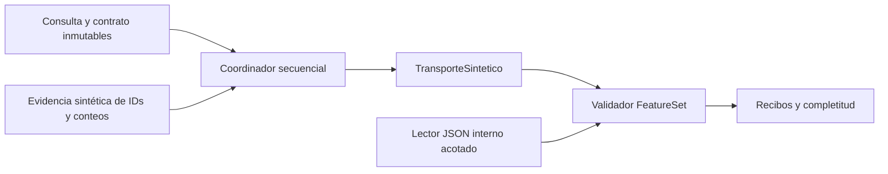

# PASO 83-A: arquitectura vectorial offline

Estado: prototipo sintético, contrato **0.1**. No constituye un conector INGEMMET
ni habilita una adquisición operativa. Fecha de trabajo: 4 de noviembre de 2026.

## 1. Alcance y antecedentes

Se parte de `313363e`, rama `feature/suadc-http`, repositorio limpio y 1164 pruebas
anteriores. El PASO 82-D quedó registrado en ese commit. Su
[informe de metadatos](validacion_metadatos_ingemmet_paso82.md) y la
[matriz de interoperabilidad](matriz_interoperabilidad_ingemmet.md) distinguen
declaraciones de la fuente y capacidades ejercidas. No se abrió su evidencia real.

Los anuncios de Feature Layer, Polygon, OID, campos, MaxRecordCount, formatos y
paginación no comprueban que funcionen las consultas de entidades de INGEMMET.
Este paso no consulta servicios, no usa polígonos institucionales ni acredita
derechos de uso. Todos los identificadores y coordenadas de las pruebas son
inventados y se identifican como tales.

## 2. Componentes y responsabilidades



- `vectorial/modelos.py`: identidad, procedencia, esquema, presupuestos y resultados.
- `vectorial/validador.py`: una página por llamada, con salida profundamente inmutable.
- `vectorial/simulado.py`: secuencia perezosa de respuestas inventadas; no recibe URL,
  cliente, backend HTTP ni callback de conexión.
- `vectorial/coordinador.py`: planes declarativos por página, contraste de evidencias,
  cancelación, cuotas y resultado de la coordinación. Descarta las geometrías entre
  páginas; entrega recibos, no una colección de todas las entidades.
- `_json_acotado.py`: lector interno compartido extraído del inspector existente.
  No tiene transporte, archivos, SQLite ni política institucional.

Se reutilizan `Fuente`, `ProcedenciaCatalogo` e `instante_utc`. La procedencia del
catálogo importa transitivamente definiciones RAW, pero el prototipo no las
instancia ni realiza operaciones de almacenamiento. Una importación limpia no
carga HTTPX, transporte HTTP, integración HTTP→RAW ni el ensayo ArcGIS.

El inspector de metadatos conserva sus firmas, estados y topes: 1 MiB de cuerpo,
131072 nodos de documento y 20000 esenciales. Solo delega su lector privado al
componente común. No se cambia un contrato público previo. El planificador actual
organiza solicitudes temporales y estaciones/variables; no se le asignan períodos
o estaciones ficticios para representar una consulta espacial.

## 3. Contratos e identidades

| Contrato | Contenido y alcance |
|---|---|
| `RecursoVector` | Fuente/institución, producto, recurso, servicio, capa y procedencia catalogada |
| `ConsultaVector` | ID de adquisición, ID de consulta, recurso, esquema, parámetros exactos, creación UTC y versión |
| `ContratoFeatureSet` | Campos, OID, tipo geométrico y CRS esperado de **respuesta** |
| `CampoVector` | Nombre original, tipo ArcGIS soportado y nulabilidad explícita |
| `ReferenciaEspacial` | `wkid` y `latestWkid` opcional, sin atribuir definición autoritativa |
| `EvidenciaConjunto` | Huella de consulta, conteo, IDs, fechas separadas y declaración de instantánea sintética |
| `SolicitudPagina` | Adquisición, huella, número y parámetros exactos de esa página |
| `RespuestaSintetica` | ID de respuesta, fecha, bytes, solicitud, HTTP simulado, longitud/transferencia y evidencia remota simulada |
| `EntidadVector` | OID observado, atributos originales, estado y geometría originales e identidad lógica opcional |
| `PaginaValidada` | Resultado estructural, entidades, CRS declarado, SHA-256 observado, tamaño y diagnósticos |
| `ReciboPagina` | Solicitudes esperada/observada, respuesta/fecha, hash, tamaño, número de entidades, estado y flag de límite |
| `ResultadoVector` | Consulta, evidencia, estrategia, recibos, totales, completitud, límites y limitaciones |

Los modelos son `dataclass(frozen=True)`; los parámetros se copian a mapas de solo
lectura, los atributos a snapshots y las coordenadas a tuplas anidadas. No se
normalizan nombres, valores ni orden. La vinculación de una entidad a página y
adquisición se conserva en el contenedor y su solicitud, sin copiarla a cada vértice.

El OID se interpreta únicamente en el espacio de esa capa/consulta/instantánea.
No se usa como identidad institucional universal ni se deduce identidad lógica de
él, de una ruta o del hash. El validador deja `identidad_logica=None`. El
`object_id` de MD-02 y el `asset_id` de MD-03 siguen siendo conceptos diferentes.

La huella canónica de consulta incluye recurso, parámetros, esquema, CRS y versión;
no incluye el ID de adquisición. Dos adquisiciones pueden repetir una consulta.
El SHA-256 del cuerpo identifica bytes, no entidades ni equivalencia geométrica.
Ninguna identidad se genera para datos institucionales reales.

## 4. Validación de sintaxis y campos

El lector comprueba bytes, UTF-8 estricto (BOM admitido), profundidad, cardinalidad
y nodos antes de materializar con `json.loads`. Este parser comprueba la gramática
completa, incluidos finales y sufijos. Rechaza claves duplicadas en cualquier nivel,
también escapadas, NaN, Infinity y enteros de más de 32 caracteres. El modo binario
también rechaza desbordes y, desde el PASO 83-B, subdesbordamiento a cero.
Después recorre el árbol completo para comprobar el presupuesto y las cadenas.
La frontera de recorrido usa iteradores O(profundidad).

Se rechazan estado HTTP simulado distinto de 200, longitud contradictoria,
transferencia incompleta y `error` ArcGIS incluso con HTTP 200. Un error no incluye
cuerpo ni mensajes remotos en los diagnósticos.

Se exige `features` como lista, `attributes` como objeto y el esquema completo
explicitado en `fields`/`objectIdFieldName`. Cada atributo debe corresponder
exactamente al contrato; ausencia, nulo y valor no se sustituyen entre sí. OID
ausente, nulo, booleano, negativo, fuera de entero de 64 bits o repetido se rechaza.
Los huecos numéricos de OID no prueban pérdida de entidades.

Tipos implementados: OID, SmallInteger, Integer, BigInteger, Single, Double,
String, Date, GUID y GlobalID. Enteros requieren `int` exacto y rango técnico;
booleanos no se aceptan como números. Reales/Date mantienen números finitos
originales; Date no adquiere zona horaria ni se convierte a datetime. GUID/GlobalID
solo reciben comprobación textual: no se acredita su unicidad institucional.
Blob, Raster, XML y tipos temporales adicionales quedan fuera del prototipo.
Aliases, dominios y semántica temática no se interpretan.

Desde el PASO 83-B se distingue `PrecisionNumerica.BINARIA_COMPATIBLE`, por defecto
para conservar las interfaces anteriores (`int`/`float`), de `DECIMAL_EXACTA`, optativa
(`int`/`Decimal`). Ambos modos leen temporalmente los decimales de forma exacta para
comprobar la estructura; la conversión binaria solo se aplica después. La política
queda en `PaginaValidada.precision` y `ResultadoVector.precision`, fuera de la
identidad de consulta. No cambia parámetros, versión del esquema ni huella de bytes.

El modo exacto conserva el valor decimal finito dentro de sus presupuestos, sin
operaciones científicas ni dependencia de la precisión del contexto decimal. No
certifica representabilidad IEEE de Single/Double, rangos científicos ni exactitud
instrumental. El modo binario puede redondear cifras y colapsar vértices cercanos;
no debe usarse para exigir preservación numérica exacta. No convierte un decimal
no nulo en cero silenciosamente. La salida científica futura requiere revisar la
política explícita; para el piloto se propone el modo exacto.

Ningún modo conserva necesariamente la notación textual: los bytes originales
permanecen en la respuesta durante la inspección y son la evidencia de representación
exacta. No hay serializador Decimal ni persistencia nuevos. `json.dumps` no admite
Decimal por defecto; convertirlo a `float` o texto no reconstruye el recurso original.

## 5. Geometrías y CRS

Se distinguen `geometry` ausente, nula y presente. Los dos primeros casos se
conservan como evidencia; no se rellenan con geometrías inventadas.

El alcance implementado es `esriGeometryPolygon` lineal XY: anillos no vacíos,
al menos cuatro posiciones por anillo, cierre explícito, dos números finitos por
posición y presupuestos por entidad/página. El cierre se contrasta con valores
decimales exactos, antes del redondeo compatible. No se reordena, orienta, simplifica
ni repara. Se rechazan curvas, Z/M, cuantización `transform` y propiedades de
geometría ajenas al subconjunto soportado.

Se preserva el CRS declarado y se contrasta exactamente con el esperado, también
cuando aparece en una geometría. No se presume equivalencia de WKID ni se completa
un `latestWkid` ausente. WKT, referencias verticales, unidades, datum/ejes y
reproyección no están implementados. El CRS esperado es el de **la respuesta**;
no se deduce del CRS nativo o del extent de metadatos anteriores.

La estructura válida no acredita topología. Una figura autointersecada puede
pasar esta inspección estructural. No se comprueban orientación, agujeros, área,
distancia, validez geológica ni correspondencia con una región real.

## 6. Planificación de páginas

Las tres estrategias están implementadas únicamente contra `TransporteSintetico`:

| Estrategia | Parámetros/controles |
|---|---|
| OFFSET | `resultOffset`, `resultRecordCount`, `orderByFields=OID ASC`; exige orden estrictamente creciente |
| OBJECT_IDS | Lotes de IDs previamente documentados, conserva el orden del manifiesto; contrasta exactamente cada lote, sin exigir orden no solicitado a la respuesta |
| CONTEO_DOCUMENTADO | Secuencia por offset contextualizada por un conteo previo; no convierte el conteo en prueba de pertenencia |

La consulta base no admite parámetros de paginación reservados. Son declaraciones
de texto: no se evalúan expresiones, SQL, imports ni archivos de reglas. No existe
serialización a un endpoint ni construcción de `/query`.

Una página corta no termina por sí sola la consulta. Si hay continuación se avanza
por la cantidad observada, sin saltar el resto por el tamaño solicitado. Se
contrastan el eco de solicitud, número, parámetros, cronología, identidad de
respuesta, hash repetido, OID duplicados, orden, IDs esperados, conteos y cambio de
instantánea. El número de páginas acota incluso una secuencia infinita.

Una página vacía con continuación, fin contradictorio, IDs ajenos o lote incompleto
detiene la coordinación. Un lote OBJECT_IDS incompleto sin anuncio de límite se
trata como inconsistente; un subconjunto con `exceededTransferLimit=true` queda
INCOMPLETA_POR_LIMITES. Si llegan todos los IDs del lote y ese flag es `true`, hay
una contradicción aunque falten otros lotes: un final correcto posterior no la
puede ocultar. No se divide ni reintenta. Una lista de IDs vacía no genera
`objectIds=""`, que podría tener interpretación ambigua en un futuro servidor.
Para comprobar un conjunto vacío se usa evidencia explícita y página vacía por
offset. No se presume que estos parámetros funcionen en INGEMMET.

## 7. Completitud y evidencia

| Estado | Criterio aplicado |
|---|---|
| COMPLETA_COMPROBADA | IDs documentados exactos, consulta/cronología coherentes, garantía **sintética** de instantánea con identidad coincidente en cada página, ausencia de contradicciones y fin explícito `exceededTransferLimit=false` |
| PARCIAL | Operación interrumpida/cancelada o fixture agotada tras recibir entidades, sin prueba suficiente de fin |
| INCOMPLETA_POR_LIMITES | Cuota de bytes, estructura, geometría, páginas, agregados, evidencia o memoria auxiliar agotada |
| INCONSISTENTE | Contradicción detectable, página inválida, errores ArcGIS/HTTP simulado, duplicados, cambios o pérdida detectable de continuidad |
| DESCONOCIDA | No hay evidencia suficiente; incluye fin anunciado o conteo coincidente sin prueba exacta de conjunto/instantánea |

`exceededTransferLimit=true` significa que no se debe presumir fin. `false` solo
informa sobre esa respuesta; no acredita por sí mismo la colección. Ausencia del
flag se conserva como `None`. `EstadoPagina.VALIDA` significa recepción completa y
estructura dentro del subconjunto soportado, nunca completitud remota.

Un conteo coincidente admite conjuntos distintos del mismo tamaño. Incluso IDs
coincidentes sin instantánea no excluyen cambios en atributos/geometrías. Se
conservan fecha del conteo/evidencia, fecha de IDs y fecha de cada página. No hay
inferencia de instantánea por proximidad temporal. La declaración de garantía es
un dato del escenario sintético, no una capacidad del servidor comprobada.

`entidades_recibidas` cuenta entidades de páginas incorporadas a la coordinación,
después del contraste de IDs/orden; los recibos mantienen el conteo estructural de
cada página inspeccionada, incluidas rechazadas. No sumar recibos repetidos como
entidades únicas. `bytes_recibidos` cuenta todos los bytes de fixtures observadas,
incluso las rechazadas antes de inspección; puede exceder la cuota al recibir la
última fixture. `bytes_inspeccionados` mantiene el total admitido bajo la cuota
agregada. Un cuerpo rechazado por esa cuota no se hashea ni parsea, pero deja
recibo NO_INSPECCIONADA con su tamaño real. El rechazo por solicitud/cronología
también preserva ese recibo y el eco original. No son mediciones de tráfico de
red: no existe tal tráfico aquí.

El SHA-256 es el cálculo de los bytes de la fixture en memoria. En una interrupción
solo corresponde a los bytes disponibles; el estado impide presentarlos como
recurso completo. Cuerpos mayores del presupuesto no se recorren para hash. No se
abre un archivo para comprobar integridad física ni se confirma un original RAW.

## 8. Presupuestos de seguridad

Valores locales por defecto de `LimitesVector`; todos son configurables con
enteros positivos. Los nuevos topes numéricos solo pueden reducirse. Profundidad
máxima configurable: 64. Los demás presupuestos tienen
techo administrativo de 536870912 unidades; no conviene elevarlos sin medición.

| Presupuesto | Valor por defecto |
|---|---:|
| Bytes por respuesta | 8388608 (8 MiB) |
| Profundidad JSON | 32 |
| Nodos (contenedores, claves y valores) | 500000 |
| Elementos por lista | 100000 |
| Propiedades por objeto | 256 |
| Caracteres por cadena | 65536 |
| Caracteres de token decimal, incluido signo/exponente | 256 |
| Valor absoluto del exponente decimal escrito y almacenado | 4096 |
| Entidades por página | 2000 |
| Atributos por entidad | 128 |
| Anillos por entidad | 256 |
| Posiciones por entidad | 50000 |
| Posiciones acumuladas por página | 100000 |
| Páginas | 100 |
| Entidades incorporadas totales | 20000 |
| Bytes acumulados admitidos | 67108864 (64 MiB) |
| Memoria auxiliar contabilizada | 8388608 (8 MiB) |

El contrato de campos admite como máximo 128 descriptores y solo dimensiones XY.
Los topes numéricos se comprueban antes de construir Decimal y antes de convertir
a float. No son umbrales ambientales. El inspector de metadatos mantiene su lector
binario previo, sin estos nuevos topes vectoriales ni modificación de límites HTTP.
La copia inmutable de una geometría tiene un techo adicional de 500000 nodos y
64 niveles, también al construirla directamente; agotarlo produce un estado
limitado, sin atribuir un error de sintaxis al JSON válido.
La evidencia admite como máximo 100000 IDs antes de aplicar la cuota de la operación.
Parámetros: máximo 64, claves de 128 y valores de 8192 caracteres; los lotes de IDs
que no caben se detienen con diagnóstico, sin peticiones ni ajuste automático.

Memoria auxiliar: se reservan 128 bytes por ID de evidencia, 128 por OID visto o
reservado para la página solicitada y, por recibo, 4096 bytes más ocho veces el
número de caracteres de sus parámetros. La reserva ocurre antes de consumir la
fixture. Es una cuota lógica conservadora de estructuras de coordinación, **no
una cota de RSS**. No incluye el cuerpo, árbol JSON y snapshot de la página actual,
que tienen sus presupuestos propios. El parser no es incremental: materializa
una página acotada. Las mediciones `tracemalloc` sintéticas no garantizan memoria
en todos los intérpretes o entradas reales.

Desde el PASO 83-B también se contabiliza un eco de solicitud que sea un objeto
distinto: 4096 bytes más ocho veces los caracteres de sus parámetros. Si no cabe,
se omite explícitamente `solicitud_observada` y se registra
`eco_omitido_por_limite_auxiliar`, sin hash ni inspección del cuerpo. Una
contradicción ya detectable permanece INCONSISTENTE; si el eco solo es otra copia
igual de grande, se detiene INCOMPLETA_POR_LIMITES. No se conserva metadata ajena
por encima de la cuota para completar el recibo.

Las fixtures se consumen con iteradores, sin acumular cuerpos o geometrías. Si
el llamador crea una lista con todas las páginas, esa memoria ya existe fuera del
coordinador; debe utilizarse un generador. Se conserva un manifiesto de recibos y
conjuntos de control acotados para detectar duplicados.

Estos 8 MiB son una política de **inspección offline**, no una ampliación del
límite de `ClienteHTTP.get()` ni una autorización de transferencia. No se aumenta
ningún presupuesto del inspector de metadatos ni del transporte operativo.

## 9. Cancelación, interrupción y reanudación

Se acepta `threading.Event` antes de la operación, entre páginas, durante la
prelectura/recorrido JSON y la validación de entidades/anillos/coordenadas.
Cancelación es cooperativa: `json.loads` y la creación del snapshot tienen trabajo
acotado pero no interrupción instantánea. No hay hilos, temporales ni descriptores
abiertos del prototipo que limpiar.

Una interrupción sintética conserva recibos anteriores y registra el estado de la
página interrumpida; no reintenta ni continúa. No se implementan checkpoints,
reanudación, recuperación tras apagado, repetición automática ni atomicidad.
Los recibos sirven al diseño posterior de trazabilidad; no constituyen persistencia
durable. Reusar una instancia de transporte consume su secuencia restante y no
equivale a reanudar una adquisición. `intentos` cuenta respuestas sintéticas
consumidas, nunca solicitudes HTTP reales.

## 10. Seguridad, concurrencia y límites de confianza

El coordinador admite el tipo exacto `TransporteSintetico`: no acepta un cliente
HTTP por duck typing ni una subclase con red. Ningún módulo vectorial importa el
transporte HTTP. No hay URL ejecutable, credenciales, instalación, migración o
almacenamiento operativo en el flujo. Los parámetros sensibles conocidos se
rechazan; parámetros, cuerpos, geometrías y procedencia no se incluyen en `repr`.
Los diagnósticos son códigos fijos, sin mensajes remotos ni excepciones del sistema.
Los IDs y metadatos públicos deben seguir siendo revisados por el llamador: no se
promete detectar cualquier secreto arbitrario incluido en un texto de origen.

Las pruebas además se ejecutan con guardia local que bloquea red y acceso a RAW,
staging/SQLite operativos y directorios de evidencia real. Eso es instrumentación
de verificación fuera del repositorio, no un sandbox distribuido con la biblioteca.
Python malicioso suministrado como generador por un llamador ya ejecuta código:
el transporte no pretende aislarlo. La configuración no carga código ni conecta.

Solo se admite uso secuencial. No hay bloqueos entre procesos ni transacciones
multirrespuesta. Con cambios concurrentes del servidor solo se detectan las
contradicciones observables. Conteos estables o páginas ordenadas no excluyen
ediciones silenciosas. Sin garantía externa verificable se declara la limitación
y no se emite COMPLETA_COMPROBADA.

## 11. Integración futura, exclusivamente diseñada

El [transporte HTTP](transporte_http.md), las
[descargas](descargas_http.md) y la [integración HTTP→RAW](integracion_http_raw.md)
permanecen separados. Un futuro adaptador deberá reutilizar orígenes autorizados,
TLS, ausencia de redirecciones, límites, cancelación y política de reintentos
existentes; no introducir un segundo cliente. Este adaptador **no existe** aquí.

El diseño futuro deberá conservar cada respuesta original y manifiesto de consulta
como adquisiciones trazables, sin confundir hash/OID/objeto/activo. RAW verificará
físicamente bytes y persistencia por sus propios contratos; el validador vectorial
no lo reemplaza. Faltan decisiones sobre publicación multiactivo, fallos entre
páginas, recuperación y evidencia documental. No se presume atomicidad del conjunto.

Tampoco se implementan GeoJSON, PBF, puntos/líneas, Z/M/curvas, WKT, reproyección,
validación topológica, diccionario litológico, QA/QC científico, catálogo GIS
persistente ni conexión al planificador de ejecución.

## 12. Condiciones para un piloto real

Requieren revisión y nueva autorización expresa:

1. Derechos de acceso, licencia, atribución y redistribución aplicables a la capa.
2. URL exacta, alcance de consulta, selección mínima y capacidades realmente
   disponibles: offset, IDs, conteos, ordenación y límites del servidor.
3. CRS de respuesta solicitado/comprobado, contrato de campos real y tratamiento
   de nulos, geometrías omitidas, cuantización y tipos no soportados.
4. Presupuesto HTTP autorizado por respuesta y operación, páginas, tiempo,
   entidades, geometría, memoria y espacio; el anuncio 2000 no fija estos límites.
5. Estrategia de instantánea/edición y evidencia de completitud verificable. Si no
   existe garantía de instantánea, mantener completitud condicionada/desconocida.
6. Diseño y pruebas de adaptador al cliente existente y conservación HTTP→RAW,
   sin habilitar red por simple configuración de las fixtures.
7. Manejo de parciales, persistencia del manifiesto, recuperación y revisión de
   concurrencia/durabilidad antes de cualquier automatización.

El dictamen del prototipo es **APTO CON RESTRICCIONES** para revisión de arquitectura
y ensayos sintéticos. No autoriza un piloto institucional ni afirma que INGEMMET
haya servido o paginado entidades.

## 13. Verificación histórica del PASO 83-A

Entorno comprobado mediante el intérprete de `.venv`: Python **3.15.1**, HTTPX
**0.28.1** y SQLite **3.53.4**. No se instalaron dependencias.

Comandos ejecutados, con `src/` y la guardia temporal añadidos únicamente al
`PYTHONPATH` de los procesos de verificación:

```powershell
.\.venv\Scripts\python.exe -B -m unittest discover -s tests -v
.\.venv\Scripts\python.exe -B -m pip check
git diff --check
git status --short
git status --short --untracked-files=all
```

La salida completa de unittest se conservó en `suite_completa.log` dentro del
directorio temporal aislado de verificación del PASO 83-A, fuera de Git. Resultado
final: **1272 ejecutadas, 1272 aprobadas, 0 fallidas, 0 errores**, en 147.834 segundos.
Se contrastaron los identificadores ejecutados contra los métodos `test_` del
commit inicial: las **1164 anteriores** siguen presentes y aprobadas, más **108
nuevas**, sin identificadores duplicados ni anteriores omitidos.

Las pruebas nuevas están en
[validación y contratos](../tests/test_vectorial_featureset.py) y
[coordinación y seguridad](../tests/test_vectorial_coordinacion.py). Incluyen
JSON ambiguo/truncado, campos/OID, nulidad/ausencia geométrica, CRS, límites,
cancelación, cambios simulados, las tres estrategias, conteos que no prueban
completitud y contradicciones por lote. Las pruebas de memoria comprueban
liberación de respuestas/entidades mediante referencias débiles y consumo
perezoso con cuerpos de 50000 caracteres; no se presentan como garantía de RSS.

`pip check`: **No broken requirements found.** `git diff --check`: sin hallazgos.
También se comprobaron sintaxis y compilación en memoria sin `.pyc`, nombres
duplicados por ámbito, espacios finales, finales de línea y enlaces locales de
este documento. El AST del lector compartido coincide con el lector anterior,
salvo la parametrización explícita de sus políticas.

Git inicial: limpio, rama `feature/suadc-http`, HEAD `313363e`. Git final: mismo
HEAD, un archivo modificado y nueve nuevos sin seguimiento:

```text
 M src/spica/adquisicion/inspeccion_arcgis/inspector.py
?? docs/adquisicion_vectorial_offline.md
?? src/spica/adquisicion/_json_acotado.py
?? src/spica/adquisicion/vectorial/__init__.py
?? src/spica/adquisicion/vectorial/coordinador.py
?? src/spica/adquisicion/vectorial/modelos.py
?? src/spica/adquisicion/vectorial/simulado.py
?? src/spica/adquisicion/vectorial/validador.py
?? tests/test_vectorial_coordinacion.py
?? tests/test_vectorial_featureset.py
```

La guardia de los procesos instrumentados registró **cero intentos prohibidos**.
No se realizaron conexiones ni consultas de entidades, no se abrió la evidencia
real y no se accedió a RAW, staging o SQLite operativos. No se verificaron sus
hashes, precisamente para respetar la exclusión de acceso. No se modificaron
`main.py`, `.gitignore` ni `.venv`; no hubo descargas, migraciones, commits o push.
Quedan pendientes las decisiones y condiciones del piloto de la sección 12.

## 14. Auditoría del PASO 83-B

El [informe de precisión e integridad](auditoria_vectorial_paso83b.md) registra los
defectos reproducidos, correcciones y regresiones. El
[protocolo institucional propuesto](protocolo_piloto_arcgis_paso83b.md) contiene la
matriz de permisos y una propuesta de un solo GET, **sin ejecución ni autorización**.
No se ha integrado HTTP→RAW ni cambiado la clasificación documental institucional.
