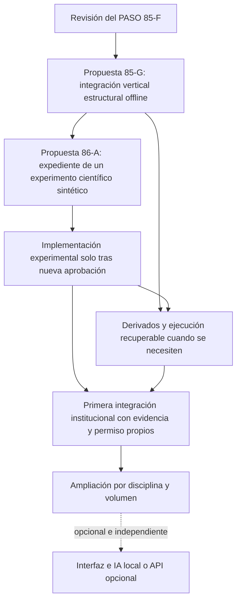

# PASO 85-F — Hoja de ruta arquitectónica y condiciones de aprobación

Fecha: **2026-11-11, America/Lima**. Base **720c0f9**, feature/suadc-http.
Este documento contiene **propuestas para revisión**, no autorizaciones de
implementación, acceso operativo o ciencia. Se apoya en la
[auditoría integral](auditoria_arquitectura_integral_paso85f.md) y la
[matriz de integración](matriz_dependencias_integracion_paso85f.md); no repite su
inventario ni reemplaza documentos históricos. Se conservan decisiones existentes
y se agrupan tareas que comparten la misma frontera.

## 1. Orden recomendado y dependencias



UI/IA no son prerrequisitos de G, E o S. Derivados persistentes no son requisito
de un experimento que mantenga resultados en memoria. La integración institucional
requiere únicamente las evidencias pertinentes a su método; no exige implementar
todos los módulos ambientales. Ningún incremento se inicia en el 85-F.

## 2. Propuesta para el PASO 85-G: unión trazable de las cadenas existentes

**Objetivo:** comprobar una sola cadena vertical estructural desde una entrada
física sintética autorizada hasta JSON, consumo y conciliación, haciendo explícitos
la identidad de ejecución, la procedencia, los efectos y el cierre. No construir
un segundo motor ni un orquestador general.

Dependencias: revisión de H02/H03/H04/H10, C01–C07 y C10/C13/C21–C23; pruebas
existentes M07–M13/M17/M27–M29. Reutilizar fixtures/controladores MockTransport y
almacenes efímeros. Los ensayos 85-E ya prueban el ciclo puro: no repetir su diseño
como si faltara un comparador. La nueva evidencia es **la unión con la entrada
física y su snapshot**, actualmente M18 prevista.

Trabajo agrupado propuesto:

1. Recuperar la referencia aprobada de Etapa 1 o someter a revisión el alcance
   mínimo R01–R12, señalando qué requisitos provienen del encargo y qué diseños
   siguen propuestos. No redactar una supuesta aprobación retrospectiva.
2. Especificar una envolvente de ejecución estructural: responsable/alcance
   autorizado, modo sintético, identidad local y espacio de evaluación, entrada
   exacta, versiones/configuración, límites, cancelación, efectos permitidos,
   fases/resultado y tratamiento de interrupción. Revisar contratos ya existentes
   antes de añadir un DTO. No convertir recomendaciones o estados en credenciales.
3. Componer una ruta de adquisición con MockTransport y RAW temporal, sin real
   internet ni inicialización operativa: mismo ClienteHTTP/AdaptadorHTTPRAW,
   recuperación física y lectura CSV. Transferir explícitamente la identidad
   del activo y evidencia a ProcedenciaQA, sin inventar campos documentales.
   La variante manual puede reutilizar su integración ya probada; no hace falta
   crear dos caminos verticales completos para cerrar el primer incremento.
4. Ejecutar EvaluadorNivel0 sobre el lector existente, cerrar y conservar
   InformeQA, exportar con el contexto declarado, consumir y conciliar. Distinguir
   una reproducción con mismo contexto de otra ejecución con otro ID. Los límites
   de lote requieren partición explícita si el ensayo supera el presupuesto.
5. Conservar restricciones, desconocidos y errores por fase. Ante entrada corrupta,
   lote rechazado, permiso ausente o cancelación, detener el flujo sin inventar
   evaluaciones posteriores. Dejar residuos solo según política existente y
   hacerlos visibles. No invocar ciencia para probar esta cadena estructural.

Contratos afectados: principalmente composición de DeclaracionRAW/ActivoRAW,
EvidenciaDocumental/ProcedenciaQA, LectorCSV/RegistroQA, InformeQA,
ContextoExportacionQA e InformeConsumoQA/LoteQA. JSON 0.1.0 y sus estados deben
permanecer intactos salvo incompatibilidad demostrada y revisión previa. El
planificador sigue sin ejecutar automáticamente y no se conecta readquisición
al HTTP como efecto incidental.

Pruebas de aceptación propuestas:

| Prueba | Evidencia de aceptación |
|---|---|
| Ruta completa con fixture sintética y MockTransport | Igualdad de bytes, tamaño y SHA en descarga/RAW/recuperación; procedencia del mismo activo y contexto en resultados |
| Cierre de lectura y evaluación | Informe de fuente y QA reflejan EOF, límites e incompletitud reales; no éxito por terminar un generador prematuramente |
| Exportación y consumo | Resultados, IDs, versiones, desconocidos y restricciones completos, sin reconstruir silenciosamente faltantes |
| Segunda ejecución/reproducción | Contextos documentados; coincidencia o NO_COMPARABLE según política 85-E, sin inventar mapeos |
| Fallos entre fases | Corrupción, error de escritura/SQLite temporal, cancelación y límite conservan originales; no resultado científico ni éxito global falso |
| Seguridad y aislamiento | Bloqueo de conexiones y rutas operativas; HTTPS en el perfil probado; ninguna operación activada por JSON/diagnóstico/capacidad |
| Regresión | Suite completa con .venv y pip check cuando cambie código; sin pérdida de las 1709 pruebas actuales; no sumar subtests como pruebas nuevas |

Riesgos: duplicar arneses, ocultar un fallo de fase tras un éxito local, introducir
un contrato de tarea demasiado general o copiar consultas sensibles a trazas.
Cierre: prueba vertical y contrato mínimo revisados, responsabilidades de cierre
y efectos explícitos, restricciones intactas y ninguna capacidad institucional
habilitada. No se exige cola persistente, multiproceso, microservicios o una UI.

## 3. Primer experimento científico: condiciones antes de implementar

**Objetivo:** formular y fundamentar un solo método científico sobre fixtures
sintéticas, reutilizando C24 y el cierre estructural revisado. La candidatura TEMP
del 85-E sigue siendo una **recomendación**, no un umbral ni una regla aprobada.
El nombre de una variable no demuestra por sí solo la magnitud medida.

Dependencias: aceptación del cierre 85-G; contexto científico explícito y fuente
metodológica verificable/aprobada para ese experimento. En este paso no se accede
a internet ni se obtiene documentación adicional. Investigar o usar fuentes
externas más adelante requiere el alcance autorizado correspondiente.

| Condición mínima | Experimento sintético en memoria | Integración científica con datos institucionales |
|---|---|---|
| Entrada y permiso | Fixture identificada como sintética, alcance revisado; sin acceso operativo | Entrada/adquisición autorizada, mecanismo vigente y condiciones de uso aplicables |
| Identidad y procedencia | Entrada/evaluación/método/versiones explícitos; no atribuir institución | Fuente, producto, recurso, activo/adquisición y vínculo editorial pertinente comprobados |
| Unidad y medición | Unidad, magnitud, modalidad y frecuencia explícitas de la fixture; desconocidos producen no evaluación | Evidencia aplicable por variable/producto/período; ninguna conversión desde etiqueta ambigua |
| Tiempo | Solo exigir lo que el método use; sin construir instantes para una condición puntual que no los necesita | Zona, ventana/cadencia/etiqueta y vigencias demostradas cuando el método las requiera |
| Espacio e instrumento | No fabricar estación/CRS para una prueba numérica sintética | Identidad/ubicación, CRS, instrumento/ambiente e incertidumbre pertinentes al método |
| QA0 y restricciones | Estados y alcance conservados; un resultado satisfecho no habilita ciencia | Igual conservación y resolución independiente de bloqueos pertinentes, sin borrar evidencia adversa |
| Regla y revisión | Referencia, edición, parámetros, método e incertidumbre revisados; estado explícito | Aprobación y aplicabilidad documentadas para ese uso; permiso operativo independiente |
| Ejecución y recursos | Proceso confiable, límites/cancelación y cierre; ninguna expresión arbitraria desde archivos | Mismo control más política de efectos, recuperación y custodia aprobadas |
| Resultado y repetición | Originales preservados, versiones/parámetros/diagnóstico/restricciones; repetición determinista | Linaje a entradas comprobadas y evidencias de ejecución real; no solo descriptores declarados |
| Exportación e integración | Revisar compatibilidad de ResultadoCientifico y salida experimental; no relabelar JSON QA0 | Contrato científico/derivado y prueba vertical de ida/vuelta aprobados antes de persistir/publicar |

Trabajo propuesto: contrastar ReglaCientifica/RevisionReglaCientifica,
EspecificacionAplicabilidad/ExpedienteProducto y el evaluador sintético existente
contra el método escogido; identificar la frontera que falta en lugar de crear
otro catálogo. Separar documentación/aprobación de código ejecutable con registro
cerrado de métodos, sin eval/exec ni plugins cargados desde un JSON.

Pruebas de aceptación: condiciones satisfechas y no satisfechas, extremos exactos,
unidad/modalidad/frecuencia incompatibles, información ausente, incertidumbre,
regla suspendida/obsoleta y cancelación; trazabilidad y restricciones completas,
sin acceso operativo o autenticidad institucional supuesta. Una excedencia puede
ser alerta/sospecha; no prueba error ambiental, contaminación o falla instrumental.

Contratos afectados: C24 y composición de contexto/procedencia/resultados, si la
revisión demuestra necesidad. ResultadoCientifico se apoya actualmente en RegistroQA
y ProcedenciaQA: no es un esquema ambiental universal. No forzar el resultado del
evaluador de fixtures a representar una ejecución científica institucional.

Riesgos: reutilizar umbrales sin aplicabilidad, confundir aprobación de descriptor
con permiso, aplicar metadatos retrospectivamente o usar una fixture como evidencia
institucional. Cierre: especificación/revisión científica y técnica aprobadas, pruebas
del método y límites claros. **No es necesario acabar GIS, UI, IA, toda la SRS o
las 29 brechas para formular un experimento sintético acotado**; sí es indispensable
resolver cualquier requisito que ese método efectivamente necesite.

## 4. Derivados y ejecución recuperable, cuando el alcance lo exija

**Objetivo:** conservar resultados científicos sin alterar originales y reconocer
interrupciones de un flujo aprobado. Prioridad P1 H06 para persistencia/linaje;
P2 H07/H08 para escala; P0 si se pretende concurrencia o durabilidad no soportadas.

Dependencias: contrato mínimo de ejecución, un resultado/metodología revisados y
caso de persistencia real. Reutilizar proyecto/objeto/activo/revisiones y las APIs
existentes; no diseñar otro almacén si una ampliación separada y compatible basta.

Contratos afectados: relación explícita entre derivados y entradas por identidad,
tamaño/hash/versión pertinentes; método/código/configuración, ejecución, evidencia,
restricciones heredadas/nuevas, incertidumbre y estado. Un derivado debe seguir
siendo distinguible del original y de su nombre físico/hash. JSON QA0 no sustituye
un esquema de derivados científicos.

Cambios propuestos tras revisión: política de publicación y consulta separada de
RAW, historial de ejecución mínimo y recuperación que detecte sin reparar/borrar
de forma automática. Acordar primero efectos de lectura: recuperar/verificar RAW
escribe eventos, mientras que 84-C tiene una lectura especial inmutable y restringida.
No ampliar esa herramienta a catálogo general por acceso directo a tablas sin contrato.

Aceptación: cierre/reapertura, entrada intacta, linaje reproducible, interrupción
antes/después de publicación, fallos de DB/disco, ruta insegura, activo previo
conservado y revisión visible ante estado incierto. Si se exige resistencia a
apagados o respaldo, ensayar restauración en temporales bajo un procedimiento
específico; no extrapolar fsync/SQLite a toda la operación.

Riesgos: migraciones prematuras, atomicidad global prometida sin mecanismo,
duplicación de storage o un nuevo diario que invalide contratos anteriores.
Cierre: contrato y prueba de custodia adecuados al uso **secuencial aprobado**.
La concurrencia multiusuario o distribuida necesita otro hito y modelo de amenaza.
No se obliga a implementar persistencia para el primer ensayo en memoria.

## 5. Integración institucional, ampliación ambiental y escala

**Objetivo:** aplicar una cadena científica revisada a un recurso concreto con
evidencia y autorización propias, y después ampliar mediante adaptadores pequeños.
Prioridad P1 para la frontera elegida; sin autorización o aplicabilidad, H01 mantiene
el uso bloqueado. ANA/OEFA/INGEMMET no se implementan por similitud nominal con PNDA.

Dependencias: 85-G, método revisado y derivados si se persisten; expediente de
recurso, identidad/editorialidad, condiciones de acceso/uso y metadatos pertinentes.
Las 29 brechas PNDA permanecen en su informe sin modificaciones; determinar cuáles
bloquean el uso específico. INGEMMET /query requiere revisión del producto/servidor,
distribución, licencia y autorización expresa; no lo desbloquea esta hoja de ruta.

Contratos afectados: adaptadores de entrada, evidencia revisada, catálogos y
plan/decisión → operación únicamente con política explícita. Reutilizar GET/TLS,
staging/RAW, lectores, límites, estados y errores. Si un proveedor exige otro
mecanismo, especificarlo antes de programar; no simular autenticación o inventar API.

Aceptación: primero fixtures offline del producto/formato y pruebas adversariales,
luego procedimiento real único solo si se autoriza, con trazabilidad física y
documental separadas. Una prueba sintética no verifica disponibilidad del servicio.
Cerrar únicamente el recurso/uso efectivamente comprobados, conservando originales,
desconocidos, restricciones y adquisiciones idénticas legítimas.

Ampliación por disciplina: entradas de agua/hidrología/hidrogeoquímica/suelos/geología
requieren identidad, unidad/magnitud/medición, métodos y metadatos propios; no usar
TEMP/HR/PP como esquema universal. Datos GIS necesitan CRS por ámbito, geometría,
precisión/completitud y derechos; geometría estructuralmente válida no es topología
ni interpretación geológica. Raster y transformaciones permanecen pendientes.

Optimización agrupada por evidencia de escala: medir memoria/CPU/E/S y espacio
temporal, revisar paginación/índices/lecturas repetidas, topes globales, cancelación
y lotes. Mantener las verificaciones físicas necesarias. Las metas se acordarán
con fixtures y equipos representativos; no se inventan porcentajes o garantías
de memoria constante para componentes que materializan snapshots.

Riesgos: normalización científica implícita, expansión cartesiana de selectores,
historial no exhaustivo, caducidad documental y carreras. Cierre: flujo específico
probado y autorizado, no una declaración de interoperabilidad universal.

## 6. Desarrollo posterior opcional: distribución, UI e IA híbrida

**Objetivo:** ampliar experiencia de uso sin convertir IA/GIS/UI en dependencias
del núcleo científico. Prioridad P3 H09; empaquetado/importaciones/CI son P2 cuando
la distribución o mantenimiento lo requieran.

Dependencias: interfaces reales y versiones estabilizadas por integraciones, caso
de uso y límites de equipo. Cambios propuestos: empaquetado ligero y tests de
instalación/importación antes de mover herramientas; UI que muestre estados,
restricciones y permisos separados; puertos de recomendaciones opcionales para
IA local y API externa con revisión de privacidad/coste/consentimiento.

Aceptación: funciones científicas esenciales disponibles offline y sin IA; fallo
o ausencia del proveedor no cambia resultados deterministas; recomendaciones
identificadas por modelo/versión/contexto con limitaciones; ninguna instrucción
de documento/modelo puede autorizar red, mover originales o aprobar reglas.
No exigir GPU potente, nube o conexión permanente. No se puede afirmar rendimiento
de un modelo local sin escogerlo y medirlo bajo otra autorización.

Riesgos: contaminación de evidencia por inferencias, fuga de datos a APIs y
dependencias pesadas obligatorias. Cierre: integración opcional probada y
fronteras de confianza explícitas; no certificación de recomendaciones de IA.

## 7. Condiciones de aprobación y límites que pueden posponerse

Para el próximo hito bastan alcance técnico revisado, responsable de ejecución,
identidades coherentes, contratos de entrada/resultado existentes y el enlace
vertical que falta, con límites, cierre, restricciones y pruebas de fallos.
No se autoriza implícitamente red o escritura operativa porque una fixture pase.

Para el primer método científico se añaden fundamento y aplicabilidad específicos,
unidad/medición pertinentes, revisión, contrato de salida y permiso explícito.
El espacio/tiempo se exigen según la operación, sin inventarlos cuando faltan.
Un error de identidad/integridad, una contradicción pertinente no resuelta o una
solicitud fuera del alcance bloquea la aprobación del flujo afectado.

Pueden posponerse: UI final, IA, catálogo universal de unidades, GIS/raster,
ejecución distribuida, autenticación criptográfica, automatización institucional
y optimizaciones sin cuello de botella medido. Respaldo/recuperación fuerte no
pueden posponerse si se prometen durabilidad/servicio multiusuario; quedan fuera
del modelo privado secuencial actual, explícitamente limitado.

No se recomiendan microincrementos para cada DTO ni una refactorización general.
Los grupos anteriores comparten pruebas y fronteras: integración estructural,
método/evidencia, custodia/ejecución persistente y ampliación por caso. El orden
puede ajustarse por una necesidad demostrada sin reabrir decisiones estables.

## 8. Verificación documental y estado final del PASO 85-F

Se crean únicamente:

```text
docs/auditoria_arquitectura_integral_paso85f.md
docs/matriz_dependencias_integracion_paso85f.md
docs/hoja_ruta_arquitectonica_paso85f.md
```

Se comprobaron correspondencia de archivos/interfaces, destinos de enlaces locales,
IDs C01–C25/R01–R12/H01–H10/M01–M33 y coherencia entre los tres documentos. Los
archivos nuevos sin seguimiento requieren revisión directa: git diff --check
no incluye su contenido. Las verificaciones son locales y no abren URLs externas.

Resultados de las comprobaciones realmente ejecutadas:

| Comprobación | Resultado |
|---|---|
| Documentos nuevos | Tres archivos UTF-8, sin caracteres de sustitución, conflictos de merge o espacios finales, con salto final; bloques Markdown cerrados |
| Tablas y enlaces | 12 tablas coherentes incluyendo esta; 162 enlaces locales con destino existente; ninguna URL externa abierta |
| Correspondencia con código | 61 interfaces/clases/métodos contrastados por AST en 37 archivos, sin ejecutar módulos |
| Sintaxis y duplicación accidental | 156 Python (100 src, 52 tests, tres herramientas y main) compilables en memoria; sin definiciones duplicadas en el mismo ámbito léxico. No prueba ausencia de toda duplicación semántica |
| Identificadores de la auditoría | 25 componentes, 12 requisitos locales, 10 hallazgos y 33 conexiones únicos, completos y sin referencias fuera de rango |
| Pruebas citadas | Archivos existentes y 13 métodos representativos comprobados estáticamente; no ejecutados |
| Brechas PNDA | 29 IDs; columna de estado final: 2 resueltas, 17 parciales, 8 pendientes y 2 contradicciones; documento sin cambios |
| git diff --check | Código 0, sin salida |
| git diff --exit-code HEAD | Código 0, sin diferencias en archivos registrados |
| git diff --cached --exit-code | Código 0, índice sin cambios |

Comandos de cierre ejecutados:

```powershell
git diff --check
git diff --exit-code HEAD
git diff --cached --exit-code
git status --short
```

Estado final de git status --short:

```text
?? docs/auditoria_arquitectura_integral_paso85f.md
?? docs/hoja_ruta_arquitectonica_paso85f.md
?? docs/matriz_dependencias_integracion_paso85f.md
```

Rama feature/suadc-http y HEAD 720c0f9 sin cambios. Cero archivos anteriores
modificados, sin cambios en el índice; únicamente los tres entregables nuevos.
Las comprobaciones estáticas utilizan el Python de .venv con -B, biblioteca
estándar y lectura de texto, sin generar bytecode o informes auxiliares en Git.

No es necesario repetir unittest/pip check porque solo se crean documentos.
El total de 1709 corresponde al historial 85-E; hoy solo se realizó inspección
estática, lectura de metadatos del entorno y comprobaciones documentales/Git.
No se importaron módulos de SPICA, abrieron recursos operativos o enviaron
conexiones. No se ejecutaron ciencia, GET, migraciones, instalaciones o commits.
Este alcance preserva los archivos del proyecto y los datos operativos por
ausencia de acceso; no afirma comprobar físicamente un almacén mantenido cerrado.

**Dictamen: APTO CON RESTRICCIONES para revisión del expediente y preparación del
85-G propuesto. No se inicia el PASO 85-G ni se habilita un módulo científico.**
