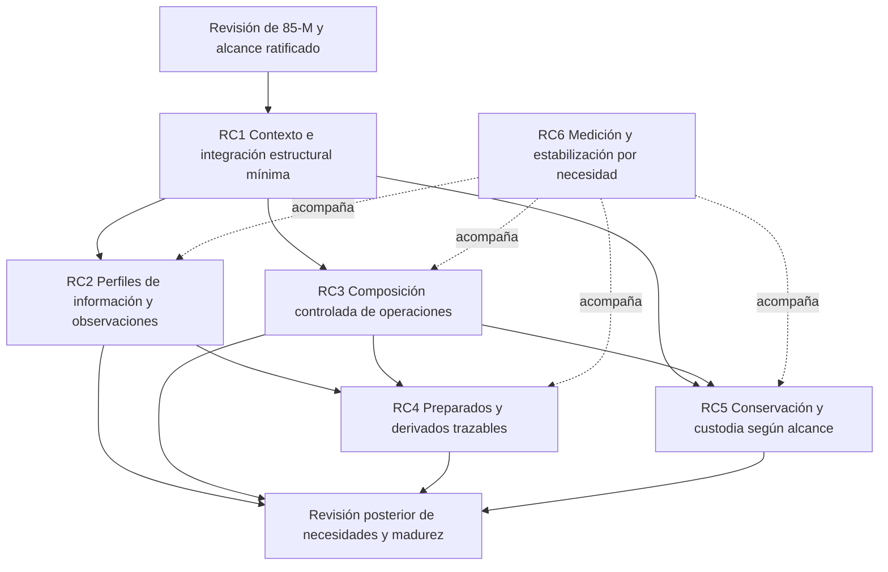

# PASO 85-M — Hoja de ruta de continuidad arquitectónica

Fecha: **2026-11-13, America/Lima**. Base **d8742fc**, feature/suadc-http.
Parte de la [auditoría](auditoria_continuidad_arquitectonica_paso85m.md) y la
[matriz](matriz_diseno_implementacion_paso85m.md). **Propuestas para revisión**:
no implementa, autoriza ni inicia ninguno de estos bloques. RC1–RC6 son grupos
de trabajo locales, no numeración de pasos aprobados o apartados de ERS.

La decisión vigente es continuar la arquitectura integral. No se fija fecha o
paso de cierre, máximo artificial de incrementos o inicio automático de ciencia.
Tampoco se exige construir toda función futura antes de evaluar un caso posterior.

## 1. Prioridad, dependencias y siguiente incremento recomendado

**Siguiente incremento recomendado: RC1, contexto transversal de proyecto,
entrada y operación estructural, con un ensayo de composición offline acotado.**
Su objetivo es conectar responsabilidades y contratos que hoy viven en RAW,
catálogos y arneses, sin otro motor, base de datos, cliente HTTP o modelo MD paralelo.
El alcance y los cambios concretos necesitan un nuevo encargo/aprobación.

La necesidad se sustenta en AM02/AM03: ProyectoCientifico no es un gestor de
proyectos de plataforma, PlanConsulta no ejecuta y ContratoEjecucion85G es un
perfil de checkout fijo. Compartir un contexto de IDs/versiones/configuración,
efectos permitidos y propietario del cierre evita que cada nuevo subsistema
invente su propia tarea, autorización o referencia a una entrada. Resolver solo
otro respaldo o comenzar un algoritmo no resuelve esa frontera.

Antes de concretar RC1 se incorpora la trazabilidad AM01/AM11: recuperar la versión
pertinente del Diseño Integral/actas si se aporta; si no está disponible, someter
el alcance local de RC1 a ratificación explícita, sin homologarlo a la ERS ausente.
No se inventan B1/DA1, estados H0/FUT o un cierre G0. No hace falta un incremento
separado para cada documento o DTO.



Las flechas son dependencias de diseño, no un calendario o automatización.
RC2/RC3 pueden desarrollarse en paralelo **como responsabilidades**, si sus
interfaces ya acordadas lo permiten; esto no autoriza trabajo concurrente sobre
almacenes ni agentes. RC4 solo cuando se abra preparación/derivados, RC5 antes
de prometer conservación operativa/única, RC6 según medición/uso. La revisión final
no significa que todos los RC deban completarse para cualquier experimento;
significa que el caso futuro debe satisfacer sus dependencias pertinentes.

## 2. Pendientes priorizados y propietarios funcionales

| Prioridad y evidencia | Dependencia/riesgo | Propuesta / componentes afectados y responsable funcional | Pruebas de aceptación necesarias / agrupación |
|---|---|---|---|
| P0 condicional: pérdida/contradicción de identidad, integridad, restricciones o permiso; H01 y barreras G–K | Ejecutar/promover un resultado sin evidencia válida o fuera de alcance | Detener el efecto/entrega afectado y conservar causa/evidencia; responsabilidad de cada frontera y composición | Casos adversariales que impiden éxito falso. No defecto crítico nuevo reproducido ni bloqueo de todos los pendientes |
| P1 AM01/AM11: diseño original/actas no disponibles y recomendación L no ratificada | Trazar implementación contra una ERS inventada o iniciar ciencia por inercia | Reconciliar fuentes/aprobaciones y alcance de contexto; responsable de arquitectura/requisitos, sin inventar aprobadores | Matriz con fuente/estado/versión y pendientes; agrupar en precondición de RC1 |
| P1 AM02/AM03: contexto/operación dispersos | Nuevas tareas/IDs/permisos incompatibles o efecto activado por un plan | Composición mínima de contexto/entrada/efectos y cierre; gestión de plataforma + coordinación de operaciones | Igualdad de IDs, aislamiento de contextos, permiso ausente, parciales/cancelación; RC1→RC3 |
| P1 AM04: perfil SENAMHI y magnitud/unidad/observación dispersos | Acoplar todas las disciplinas a 16 campos o normalizar desconocidos | Perfil y adaptación explícitos; responsabilidad de información/interoperabilidad/QA | Unidad/medición/tiempo/CRS incompatibles o desconocidos, literales intactos, perfil no SENAMHI sintético; RC2 |
| P1 AM05: preparados/resultados/derivados sin ciclo común | Escribir un derivado como original, perder vínculo de método/entrada o reutilizar JSON QA indebidamente | Contrato y publicación separados, con revisiones/linaje y restricciones; procesamiento + almacenamiento | Proyección estructural no destructiva, relación de entradas y nueva versión, errores/rollback lógico, exportación compatible; RC4 |
| P1 AM06/AM09 para uso operativo: codec/esquema/TEMP y custodia local | Respaldo incompleto o ilegible en otro perfil, pérdida de original/control | Perfil de conservación completo pertinente, portabilidad y control protegido; conservación + datos | Otro TEMP/cuenta, referencia discrepante/perdida, copia incompleta, lector sin fuente disponible; RC5, sin migraciones operativas |
| P1 composición / P2 escala, AM07 | Cotas locales no equivalen a presupuesto conjunto, RSS o reserva de disco | Inventario de recursos/efectos y límites; medir RAM/CPU/tiempo/disco antes de optimizar | Presupuesto agotado y cierre parcial, benchmark de fixture/equipo acordados; RC1/RC3 y RC6 |
| P2 actual / P1 al publicar API, AM08 | Helpers/ciclos/codec de checkout se convierten en API accidental o contrato duplicado | Mantener dependencias controladas, extraer frontera solo si RC1–RC5 lo necesitan; responsable de API/mantenimiento | Importaciones, compatibilidad de DTO/versiones, ausencia de src→arnés/tests y regresiones; RC6 junto a la frontera elegida |
| P1 AM10 para efectos autorizados | Política genérica TLS/HTTP se confunde con perfil de seguridad o autenticación de usuario | Política explícita previa al efecto y diagnóstico seguro; coordinación + transporte/configuración | HTTPS/TLS/orígenes, destino, trazas sin secretos y efectos denegados; RC3, IAM hostil/multiusuario fuera del alcance actual |
| P2 AM12: estado temporal de guía RAW ambiguo | Lectores interpretan una frase antigua como estado actual del almacén | En futuro alcance documental, separar guía vigente de antecedentes fechados; responsable de documentación/operación | Referencias coherentes sin reescribir informes históricos o sondear datos sin permiso; agrupar con RC1/RC5 |
| P3 H09/IM27/IM28 | Añadir dependencias/infraestructura no requeridas o condicionar ciencia a IA/pagos | UI avanzada, GIS/IA/servicios/comercio por caso; aplicación futura | Ciencia esencial offline, ausencia/fallo de IA no cambia salida determinista; posteriores, no parte de RC1 |

Las prioridades tienen condición y dueño de responsabilidad, no personas o fechas
inventadas. P2 puede volverse requisito del hito cuando este exija portabilidad,
escala o distribución; no se reetiquetan horizontes formales H0/FUT sin su matriz.

## 3. RC1 — Contexto y frontera estructural común

- **Objetivo/problemas:** contexto de proyecto/objeto, entrada/versión/activo,
  evaluación/tarea, configuración y alcance de una operación; AM01–AM03/AM07.
- **Subsistemas/dependencias:** gestión de plataforma, información, configuración
  y composición. Ratificación del alcance y correspondencias con MD/catálogo/G
  antes de decidir nuevas interfaces. Modelo inicial privado/secuencial/offline,
  sin sistema de cuentas, permisos empresariales o descubrimiento remoto.
- **Reutilización:** ProyectoCientifico/ObjetoCientifico/ActivoRAW, Fuente,
  RegistroRecurso/RecursoInteroperable, PlanConsulta/ResultadoDecision como
  descripciones, presupuestos/estados/InformeEjecucion85G y verificador H.
- **Contrato estrictamente necesario:** primero probar composición de los DTO
  anteriores. Solo si no expresan contexto/alcance/cierre, una envolvente mínima
  versionada de operación/entrada. No otro proyecto/fuente/activo/ResultadoQA.
  Configuración pura separada de ejecutar y de los parámetros metodológicos.
  Responsable declarado no se presenta como identidad autenticada; los permisos
  no pueden ser concedidos por un JSON o un resultado.
- **Aceptación:** un caso estructural sintético aporta explícitamente contexto y
  snapshot de entrada; se conservan IDs/versiones/controles/restricciones al usar
  los componentes actuales. Otro contexto no se fusiona por igualdad SHA. Crear
  configuración/describir operación no hace E/S. Rechazo de tipo/contexto/versión
  incompatible, efecto no autorizado y recursos prestados cerrados incorrectamente.
- **Pruebas:** fixtures en memoria/TEMP y componentes reales existentes, sin red;
  positivo, desconocidos, conflictos, límites/cancelación y preservación de todos
  los contratos previos. No simular integración sustituyendo todos los componentes.
  Las pruebas existentes G/H son la regresión del perfil fijo, no otra ejecución
  autorizada sobre datos institucionales.
- **Riesgos/cierre:** evitar DTO universal, nueva DB o src dependiente de herramientas.
  Cierra cuando un contexto y una operación acotados tienen propietario, contratos
  mapeados, efectos/presupuesto/cierre comprobados y regresión adecuada. No cierra
  toda la gestión de usuarios, planes ni arquitectura de SPICA.

## 4. RC2 — Perfiles comunes de información y observaciones

- **Objetivo/problemas:** AM04 y M23/M26, componer dataset/recurso/observación,
  magnitud/unidad/medición, referencias y faltantes sin imponer SENAMHI a todos.
- **Subsistemas/dependencias:** información, catálogo, interoperabilidad, metadatos
  y calidad. Requiere contexto/identidades RC1; no una ontología ambiental completa.
- **Reutilización:** VariableCatalogo, ProcedenciaLocal/QA, RegistroQA,
  RecursoInteroperable/MarcoTemporal/MarcoEspacial, condiciones/incertidumbre de
  modelos científicos, parser/lectores y evaluadores existentes.
- **Contratos necesarios:** perfil/adaptación de entrada y correspondencias con
  estados/evidencia. Añadir campos/tipos comunes solo por datos requeridos y no
  representables; conservar valor original junto a cualquier representación
  estructural. Unidad declarada no se deduce de nombre o rango; dimensión/frecuencia
  desconocidas siguen desconocidas. No parser de unidades ni conversión ahora.
- **Aceptación/pruebas:** perfil existente y otro caso de estructura sintética con
  campos/variables diferentes, sin atribución institucional; original intacto,
  posiciones/relaciones explícitas, tipos correctos, desconocidos/restricciones
  conservados y diagnósticos de incompatibilidad de tiempo/espacio/unidad/medición.
  Un método que no necesita una referencia no obliga a inventarla.
- **Riesgos/cierre:** no duplicar DTO de observación/catálogo o universalizar RegistroQA;
  no reconstruir HORA/UBIGEO/estación. Cierra el perfil y su adaptación probada,
  con responsabilidades claras, no toda metrología/GIS ni aplicabilidad científica.

## 5. RC3 — Composición controlada de operaciones estructurales

- **Objetivo/problemas:** hacer reutilizable el tramo estructural sin convertir
  PlanConsulta PREPARADA o recomendación en efecto; AM03/AM07/AM10, M03/M16.
- **Subsistemas/dependencias:** ejecución, planificación, transporte/local,
  configuración, lectura y QA. RC1 es previo; RC2 se exige para perfiles nuevos.
  La selección de una operación concreta y sus efectos requiere permiso propio.
- **Reutilización:** ClienteHTTP/HTTPRAW/IngestorManual, catálogos, lectores/QA,
  exportación/consumo/conciliación, Event/presupuestos/errores; G/H como referencia
  de integración, sin segundo cliente o evaluador.
- **Contrato necesario:** política y resultado de operación componen estados/fases
  reales, evidencia de efectos iniciados/terminados y parciales. Un adaptador de
  preparación→operación no es un ejecutor universal de planes ni un scheduler.
  Recurso/selector/localizador deben estar demostrados; no inventar parámetros
  institucionales. No callbacks/expresiones o código cargados desde configuración.
- **Aceptación/pruebas:** flujo local/sintético de extremo a extremo, intento fuera
  de alcance bloqueado antes de E/S, política HTTPS/TLS/origen cuando aplique,
  destino controlado, registro seguro de errores, presupuesto compuesto, cancelación,
  fallo tras publicación, retorno incierto y cierre sin borrar originales. La rama
  institucional permanece deshabilitada salvo procedimiento futuro autorizado.
- **Riesgos/cierre:** doble ejecución o éxito global por una fase local. Cierra la
  operación seleccionada y el mapeo plan/decisión→propuesta→autorización→efecto;
  estados no conceden permiso. No exactamente-una-vez, reanudación o checkpoints
  generales sin necesidad y diseño propios.

## 6. RC4 — Preparación, artefactos derivados y resultados trazables

- **Objetivo/problemas:** AM05, M32 y ciclo de vida IM17/21/24; distinguir original,
  representación preparada, resultado QA y futuro derivado científico.
- **Subsistemas/dependencias:** información/procesamiento/resultados/almacenamiento,
  con RC1/RC2 y operación seleccionada de RC3. No requiere ejecutar algoritmo
  ambiental: basta un caso de selección/proyección estructural sintética sin
  cambiar valores ni sus significados.
- **Reutilización:** identidades MD, referencias de catálogo, patrón de publicación
  exclusiva/hash/cotejo, estados/parciales y contratos de procedencia/restricciones.
  Revisar ResultadoCientifico antes de definir otro; no relabelar JSON QA0.
- **Contratos necesarios:** entrada→operación/perfil/versión/parámetros→artefacto,
  estado/tipo/versiones/controles/restricciones y formato de salida. Persistencia
  o exportación solo con perfil/codec explícitos. Elegir extensión compatible del
  registro existente si hace falta; DDL exacto impide añadir tablas silenciosas.
  No otra base de datos sin impedimento técnico demostrado.
- **Aceptación/pruebas:** bytes originales idénticos antes/después; nueva identidad
  y relación de versión, resultados parciales/errores, restricciones heredadas,
  no sobrescritura, conflicto y lectura/exportación reversible del tipo declarado.
  No guardar preparado como original RAW ni reconstruir evidencia no emitida.
- **Riesgos/cierre:** confundir caché/diagnóstico con dato preparado, perder relación
  con una entrada compartida o forzar tipos de 85-G en un codec ajeno. Cierra solo
  el artefacto/flujo estructural elegido y su linaje, sin núcleo científico general.

## 7. RC5 — Conservación operativa, portabilidad y custodia verificable

- **Objetivo/problemas:** AM06/AM09 y L01–L05; respaldo del cierre de referencias
  realmente requerido, referencia protegida y recuperación en otro perfil.
- **Subsistemas/dependencias:** conservación, información, configuración y ejecución;
  RC1/RC3 y tipos persistidos de RC4 si entran en el alcance. Derechos y ubicaciones
  operativas requieren autorización separada. No se conectan unidades aquí.
- **Reutilización:** catálogo/codec/lector 85-J, generación/backup API/copias de K,
  inspección RAW y diseño de custodia L; mantener clara la diferencia v1/v2/85001.
- **Contratos necesarios:** perfil de destino/compatibilidad y alcance completo
  pertinente de originales/índices/evidencia; separar rutas históricas inertes de
  locadores actuales sin abrirlas. Referencia previa por canal protegido y política
  de retención/revisión manual, no otro inventario SQL paralelo o hashes autocertificados.
- **Aceptación/pruebas:** primero fixtures nuevas y otro TEMP/cuenta simulado; luego
  solo si se autoriza un medio real, probar dispositivo identificado y lector sin
  origen/respaldo disponibles tras copiar. Preservar IDs/estados/restricciones,
  detectar control ausente/antiguo/discrepante, auxiliares SQLite no admitidos,
  copia incompleta, conflicto y marcador abandonado. No borrar para reparar.
- **Riesgos/cierre:** mismo dominio de fallo, autoridad compartida, versiones/codec
  incompatibles, datos únicos sin copia y promesa eléctrica indebida. Cierra el
  perfil de conservación/recuperación acordado y sus límites, no autenticidad
  institucional ni durabilidad universal. No exige nube, PKI o cifrado nuevos.

## 8. RC6 — Recursos, API y mantenimiento según evidencia de uso

- **Objetivo/problemas:** AM07/AM08 y H07/H08: medir antes de ampliar y estabilizar
  solo las fronteras que otro componente necesite consumir.
- **Subsistemas/dependencias:** transversal; acompaña RC1–RC5 sin obligar a una
  refactorización general previa. Las cotas sintéticas no equivalen a SLA/RSS.
- **Reutilización/contratos:** límites/eventos y perfiles existentes; exposición
  pública mínima de utilidades necesarias, sin duplicar validaciones. Registrar
  versiones de entorno/paquete y propiedad de recursos, evitando depender de tests
  o herramientas desde src. Mantener importaciones diferidas donde sean correctas.
- **Aceptación/pruebas:** fixtures/equipo de referencia acordados, volumen/tiempo/
  pico de memoria/disco observados, respuestas a cuota y cancelación, importaciones
  en ambos órdenes relevantes, versión incompatible y compatibilidad de interfaces.
  No eliminar relecturas de integridad como optimización sin demostrar equivalencia.
- **Riesgos/cierre:** medir un caso pequeño y prometer escala universal o fijar cifras
  sin medición. Cierra la meta del caso y su entorno, no un rendimiento genérico.
  Empaquetado/CI/distribución se implementan solo si pasan a ser necesarios, sin
  instalar herramientas en esta auditoría.

## 9. Postergables y revisión futura del inicio científico

Se posponen UI/visualización final, GIS operativo, IA especializada, APIs de IA,
cloud/sincronización, multiusuario, comercio/pagos y catálogo universal de métodos.
No se les asigna formalmente FUT mientras su matriz original no esté disponible.
IA local principal y APIs opcionales deben quedar desacopladas de resultados
deterministas; freemium no limita la calidad esencial o impone conexión/GPU/pagos.

La evaluación posterior de núcleos científicos deberá comprobar, para las
necesidades elegidas y sin fecha automática:

1. Alcance/requisitos pertinentes identificados, estados de aprobación verificables
   o ratificación local explícita, sin contradicciones de ERS/actas conocidas.
2. Contexto/IDs/entradas/versiones/procedencia y propiedad de efectos/cierre comunes;
   contrato que no imponga el perfil SENAMHI a otra disciplina.
3. Magnitud/unidad/medición, tiempo/espacio, faltantes/incertidumbre y evidencia
   requerida por ese uso explícitos; no rellenar o convertir desconocidos.
4. QA estructural, estados/errores/parciales y restricciones preservados de extremo
   a extremo; conflictos impiden promociones incorrectas.
5. Contratos de salida/derivado y linaje adecuados, con persistencia/custodia solo
   si se exige conservar datos únicos o resultados, sin falsos originales recuperados.
6. Método/referencia/versión/parámetros/aplicabilidad revisados en un expediente
   propio y autorización expresa. Esta auditoría no elige algoritmo ni satisface
   bloqueantes científicos mediante un acuerdo documental genérico.
7. Presupuesto/cancelación/perfil de seguridad, ensayos de aceptación pertinentes
   y regresión del código; no atribuir cierre por el total 1884 o por una fecha.

Ninguna de estas condiciones convierte en obligatorio completar todo RC/H0/FUT
para cualquier caso. La decisión posterior debe basarse en alcance, madurez real
y necesidades, sin declarar por ello terminada toda SPICA. Las 29 brechas PNDA
mantienen 27 abiertas; se resolverán solo las pertinentes con evidencia, no por
haber escrito arquitectura. /query INGEMMET sigue NO AUTORIZADO.

## 10. Verificaciones y cierre documental de 85-M

Las comprobaciones siguientes se realizaron con Python **3.15.1 de .venv y -B**,
biblioteca estándar, lectura/AST y Git; no importan módulos de SPICA ni crean bases,
scripts permanentes o pruebas nuevas. Los documentos sin seguimiento se revisan
directamente porque git diff --check no incluye su contenido.

| Verificación efectivamente realizada en 85-M | Resultado |
|---|---|
| Recuperación Git | Rama feature/suadc-http, HEAD d8742fc y árbol inicial limpio; 64 commits de la línea de HEAD, 85-L consolidado |
| Disponibilidad del diseño | Búsqueda de nombres/texto y rutas históricas locales sin recuperar ERS, actas B1/DA1 o matriz H0/FUT/G0; no prueba inexistencia fuera del repositorio |
| Código frente a 85-F | Diff 13744ab..HEAD sobre src/spica vacío; 100 módulos src, 9 herramientas, 56 archivos test_ y 1884 IDs estáticos únicos |
| Contratos/versiones | 35 interfaces en 14 archivos y exportaciones de siete paquetes contrastadas por AST; conservación/codec/respaldo/JSON QA 0.1.0, esquema experimental 85001 |
| Dependencias explícitas | Sin import src→herramientas encontrado; dependencias auxiliares G/H/J/K y retorno diferido H→G inspeccionados; no prueba de todos los órdenes de carga |
| Tres documentos nuevos | UTF-8, salto final, sin caracteres de sustitución, espacios finales, conflictos o bloques sin cerrar |
| Matrices/enlaces | 12 tablas con columnas coherentes; 109 enlaces locales con destino existente, ninguna URL abierta |
| IDs/coherencia | IM01–IM28 en ambas tablas, M01–M33 completos, AM01–AM12 y RC1–RC6 únicos en sus definiciones; categorías M: 28 D acotadas, 4 P, 1 O |
| Brechas PNDA | 29 IDs R/S/T/V y estados 2 resueltas, 17 parciales, 8 pendientes, 2 contradicciones, sin modificar el expediente |
| `git diff --check` | Código 0, sin salida, complementado por revisión directa de los nuevos Markdown |
| `git diff --exit-code HEAD` | Código 0, sin salida; código, pruebas, dependencias y documentos registrados intactos |
| `git diff --cached --exit-code` | Código 0, sin salida; índice sin cambios |

La última suite reportada de 1884 corresponde al 85-K; no se repite al cambiar
solo documentación ni se instala/ejecuta herramienta de pruebas adicional.
No se vuelve a ejecutar pip check ni se interpreta un recuento AST como aprobación.

Se crean únicamente:

```text
docs/auditoria_continuidad_arquitectonica_paso85m.md
docs/matriz_diseno_implementacion_paso85m.md
docs/hoja_ruta_continuidad_arquitectonica_paso85m.md
```

Comandos de cierre:

```powershell
git diff --check
git diff --exit-code HEAD
git diff --cached --exit-code
git status --short
```

Estado final de `git status --short`, código 0:

```text
?? docs/auditoria_continuidad_arquitectonica_paso85m.md
?? docs/hoja_ruta_continuidad_arquitectonica_paso85m.md
?? docs/matriz_diseno_implementacion_paso85m.md
```

Rama y HEAD siguen feature/suadc-http / d8742fc. Solo esos tres documentos son
nuevos; no se descartan/sobrescriben avances y no hay cambios en el índice.

No hay implementación, prueba ejecutable nueva, lectura/escritura de datos reales,
operación sobre RAW/staging/SQLite operativo, CSV o evidencia privada, conexión/GET,
descarga, instalación, migración, ciencia, IA/GIS operativo, commit o push.
No se cambia la ERS, contratos o documentos previos, las 29 brechas o permisos.

**Dictamen: APTO CON RESTRICCIONES para revisión y continuidad arquitectónica.**
El Diseño Integral original no recuperado impide una declaración exhaustiva de
conformidad. RC1 es recomendación del siguiente encargo, no aprobación ni ejecución.
No se inicia Etapa 86, no se selecciona algoritmo y no se declara completada la
arquitectura. Se espera auditoría del usuario antes de continuar.
