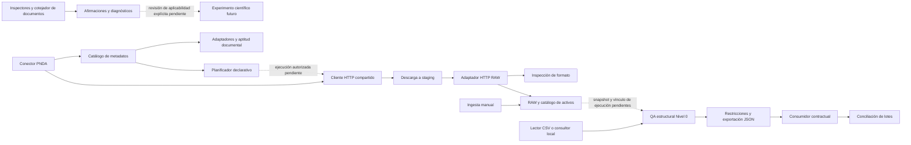

# PASO 85-F — Dependencias, contratos y conexiones de integración

Fecha: **2026-11-11, America/Lima**. Base: **720c0f9**, feature/suadc-http.
Los C01–C25 y H01–H10 están definidos en la
[auditoría integral](auditoria_arquitectura_integral_paso85f.md). Esta matriz
documenta el estado observado; los enlaces previstos **no son implementaciones**.
Su resolución se propone en la [hoja de ruta](hoja_ruta_arquitectonica_paso85f.md).

## 1. Estructura inspeccionada y dirección de las relaciones

```text
src/spica/
  adquisicion/
    nucleo/                  contratos y tiempo
    transportes/             GET, descargas y reintentos
    almacenamiento/          RAW, SQLite, configuración e inspección
    catalogo/                entidades, revisiones y evidencia de adquisición
    planificacion/           propuestas declarativas
    conectores/senamhi/       PNDA, piloto XLSX
    integracion/             HTTP→RAW
    manual/                  entrega local documentada
    readquisicion/           recomendación previa sin E/S
    verificacion/docx/       inspección general, CSV y OOXML
    consultas_locales/       perfil CSV SENAMHI
    inspeccion_arcgis/       metadatos, no entidades
    vectorial/               FeatureSet y coordinación sintéticos
    piloto_arcgis/           simulación y evidencia temporal
    _json_acotado.py         parser compartido interno
  interoperabilidad/         snapshots, aptitud y propuestas documentales
  metadatos_documentales/    afirmaciones, referencias y restricciones por uso
  perfilado/                 perfil representacional e índice temporal
  calidad/
    aplicabilidad/           cotejo documental de requisitos
    experimental/            límites solo para fixtures sintéticas
    modelos/reglas/motor     Nivel 0
    exportacion/consumo/conciliacion_lotes.py
herramientas/                tres componentes de checkout, no CLI global
tests/                       52 archivos; 1709 métodos test_ estáticos
docs/                        contratos, expedientes, auditorías y propuestas
main.py                      únicamente mensaje de inicio
requirements.txt             httpx==0.28.1
```

La abreviatura modelos/reglas/motor representa archivos .py, no un subpaquete.
verificacion contiene también los módulos CSV/XLSX generales. No hay paquete de
ejecución global, almacén de derivados, módulos disciplinares, UI o IA en src.

Las flechas siguientes representan **datos/llamadas demostrados por código y
pruebas localizadas**. Las discontinuas son necesidades futuras, no conexiones
ejecutables disponibles. Ninguna flecha afirma un flujo institucional autorizado.



RAW→QA discontinuo significa ausencia de un **contrato/ensayo vertical completo**;
existen puentes locales particulares (84-C) y adaptación de observaciones, no una
prohibición de leer un activo bajo otro procedimiento autorizado. DOC→AF expresa
cotejos que conservan afirmaciones; no las aprueba automáticamente. La flecha
HTTP→DESC indica la llamada común, no que get pequeño escriba en staging.

## 2. Matriz de conexiones

D = demostrada por llamadas y tests inspeccionados; P = prevista; O = opcional.
D califica el alcance sintético/local, no el funcionamiento externo actual. Prueba
localizada no significa prueba ejecutada en el 85-F. P0 condicional mantiene
bloqueado un uso inseguro; P1/P2/P3 conservan el significado de la auditoría.

| ID | Emisor → receptor | Interfaz / contrato y datos | Estado / prueba existente | Riesgo / condición y pendiente / prioridad |
|---|---|---|---|---|
| M01 | C01 → C08 | SolicitudAdquisicion dentro de ConsultaProducto/SolicitudCientifica; fuentes, selectores y período | D; [núcleo](../tests/test_adquisicion_nucleo.py), [plan](../tests/test_planificacion.py) | Fechas son obligatorias en la solicitud; no inventar período para archivos estáticos. Mantener vía directa / P2 según nuevo caso |
| M02 | C07 → C08 | CatalogoCientifico.leer_acotado; registros/revisiones y disponibilidades explícitas | D; [planificación](../tests/test_planificacion.py): multivariable_multiestacion_sin_cartesiano, lectura_acotada_filtra_y_libera_transaccion | Asociación catalogada no prueba cobertura completa o disponibilidad remota. Ejecutable siempre False / P1 para ejecución |
| M03 | C08 → C09/C02 | No existe ejecutor de PlanConsulta ni traducción institucional de selectores a parámetros HTTP | P; [plan](../src/spica/adquisicion/planificacion/modelos.py) y test_plan_no_genera_localizadores | No sustituir capacidad PREPARADA por permiso. Necesita mecanismo, presupuesto y autorización por recurso / P1 H02 |
| M04 | C09 → C02 | ConectorSENAMHIPNDA.descubrir usa ClienteHTTP.get, página HTML y enlaces dcat | D; [conector](../tests/test_conector_senamhi_pnda.py): identificacion_fuente_producto_recurso, cambio_html_falla_cerrado_y_revoca_descubrimiento | Parser de producto y fuente fijos; no autentica editor de otra página. Sin login, filtros remotos o conectores nuevos / P2 ampliación revisada |
| M05 | C09 → C07 | registrar_catalogo → registrar_documental; fuente, producto, capacidad y recurso | D; [conector](../tests/test_conector_senamhi_pnda.py), [registro](../tests/test_registro_evidencias.py) | Transacciones por registro, no lote global; contradicción/interrupción bloquea adquirir. No extender capacidad de recurso a todo producto / P1 al automatizar |
| M06 | C09 → C10 | adquirir solo diccionario XLSX publicado → adquirir_documentado(url, DeclaracionRAW, EvidenciaDocumental) | D; [conector](../tests/test_conector_senamhi_pnda.py): adquisicion_xlsx_y_continuidad_fisica, csv_y_docx_no_autorizados_para_este_piloto | Máximo piloto 1 MiB, cliente compartido. CSV/DOCX históricos no prueban ampliación de este método / P2 si se solicita ampliar |
| M07 | C04 ↔ C02/C03 | GestorReintentos.ejecutar_get; error recuperable, Retry-After, Event, RegistroIntento | D; [reintentos](../tests/test_reintentos_http.py), [integración](../tests/test_integracion_http_raw.py): reintentos_se_reutilizan_sin_duplicar_activos | Solo GET, parcial se descarta antes de otro intento; no Range, plazo total ni diario global / P1 para contrato de tarea |
| M08 | C02 → C03 | ClienteHTTP.descargar → descargar_archivo; usa _abrir/_bloques comunes | D; [descargas](../tests/test_descargas_http.py) | Funciones privadas compartidas intencionalmente dentro del mismo transporte; no crear otro cliente. Control de bytes efectivo, no solo Content-Length / mantener |
| M09 | C03 → C10 | InformeDescarga, ruta, estado, bytes, SHA, fecha y sugerencia MIME | D; [HTTP RAW](../tests/test_integracion_http_raw.py): informe_con_tamano_falso_no_se_confirma | C10 exige completa y ruta propia; coteja tamaño/hash en RAW. Un informe fabricado no evita relectura / mantener |
| M10 | C10 → C05/C07 | incorporar o incorporar_documentado con par tamaño/SHA; evidencia junto a preparación del activo | D; [HTTP RAW](../tests/test_integracion_http_raw.py), [registro](../tests/test_registro_evidencias.py) | No transacción global entre catálogo científico, RAW y archivos; fracaso posterior puede conservar activo/residuo / P1 H03 |
| M11 | C05 → C10 → C13 | recuperar → ruta verificada; verificar_archivo → ResultadoEstructura separado | D; [formatos integrados](../tests/test_integracion_formatos.py): pnda_html_conservado_sin_confirmar_xlsx, csv_vacio_integridad_correcta_estructura_incierta | Fase completada no implica formato útil o ciencia. Conservar respuesta inesperada sin promoverla / mantener |
| M12 | C06 → C05/C10 | ConfiguracionRAW.abrir/inicializar → AlmacenOperativoRAW; adaptador_http comparte almacén y staging | D; [configuración](../tests/test_configuracion_raw.py), [cierre](../tests/test_cierre_configuracion_raw.py) | Abrir sondea escritura; validar WAL puede crear copia temporal. No usar para auditoría operativa de solo lectura / P1 selección explícita de efectos |
| M13 | C05 ↔ SQLite/archivos | CatalogoRAW.preparar/transicion y publicación exclusiva; MD-01/02/03, eventos y contenido SHA | D; [RAW](../tests/test_almacenamiento_raw.py), [MD](../tests/test_modelos_md_raw.py), [regresiones](../tests/test_regresiones_altas.py) | Falta atomicidad global/lock multiusuario/restauración. Contenido compartido, activos separados; uso privado secuencial / P2, P0 si cambia el modelo |
| M14 | C11 → C05 | IngestorManual.ingestar → incorporar_manual_documentado; archivo autorizado, declaración y recibo MANUAL | D; [manual](../tests/test_ingesta_manual.py) | No cuenta como GET; no crear segunda copia definitiva fuera de RAW. Recepción no demuestra editor o permiso / mantener |
| M15 | C05/C07/C11 → C12 | antecedente_desde_raw; ActivoRAW, evidencia HTTP o recibo manual, versión y comprobación local aportadas | D en memoria; [readquisición](../tests/test_readquisicion.py) | Metadatos RAW no equivalen a verificar archivo ahora; versión documental no es versión del recurso. Obtener evidencia requiere permiso separado / P1 H02 |
| M16 | C12 → C02/C11 | ResultadoDecision es recomendación; autoriza_red=False | P para ejecución; [readquisición](../tests/test_readquisicion.py) comprueba ausencia de E/S | No hay hook anterior a GET o ingesta ni ejecutor aprobado; no activar por RECOMENDAR_NUEVA / P1 H02 |
| M17 | C13 → C15/C21 | LectorCSV → RegistroCSV; ConsultorLocalCSV → ObservacionLocal; adaptar_registro → RegistroQA | D; [consultas](../tests/test_consultas_locales.py), [Nivel0](../tests/test_calidad_nivel0.py) | Encabezado SENAMHI y valores textuales; selección local de una variable evita evaluar varias veces la misma fila / P1 H05 al añadir otro perfil |
| M18 | C05/C10/C11 → C15/C21/C22 | No hay interfaz común que entregue activo+snapshot+alcance de lectura+identidad de ejecución a toda la cadena | P; [84-C](../tests/test_integracion_local_pnda.py) prueba un puente particular y [85-E](../tests/test_conciliacion_qaqc_85e.py) el ciclo QA puro, por separado | Falta prueba vertical desde entrada física sintética hasta conciliación, con cierre/errores/restricciones / P1 H03 |
| M19 | C15/C13 → C16 | CSV y ProcedenciaLocal → perfilar_csv; interpretar_numero compartido con QA | D; [perfilado](../tests/test_perfilado_meteorologico.py), [Nivel0](../tests/test_calidad_nivel0.py) | Perfil agregado no debe ejecutarse para cada número; índice temporal y cuotas propios. Sin ciencia / P2 medir escala |
| M20 | C17 → C02 / parser | EnsayoMetadatosArcGIS y RespuestaHTTP → inspeccionar_metadatos/ValidacionMetadatos | D para metadatos; [inspector](../tests/test_inspeccion_arcgis.py), [extenso](../tests/test_inspeccion_arcgis_extensa.py), [presupuesto](../tests/test_inspeccion_arcgis_presupuesto.py) | Ensayo no es conector de entidades; anuncio de formatos/capacidad no confirma /query / mantener bloqueo |
| M21 | C18 → parser / C19 | TransporteSintetico → validar_featureset/coordinar; RecursoVector/ValidacionMetadatos → adaptar_vectorial | D sintético; [FeatureSet](../tests/test_vectorial_featureset.py), [coordinación](../tests/test_vectorial_coordinacion.py), [adaptadores](../tests/test_adaptadores_interoperabilidad.py) | Sin puente HTTP, publicación RAW o servidor real de entidades; recibos no son dataset persistido. No extrapolar completitud / P1 solo si se autoriza GIS |
| M22 | C18 → evidencia temporal | SimuladorEnsayo → conservar_evidencia; respuesta ficticia y registro acotados | D; [piloto](../tests/test_piloto_arcgis.py), [evidencia](../tests/test_evidencia_piloto_arcgis.py) | Temporal privado y limpieza; nunca evidencia institucional o permiso. /query no autorizado / mantener |
| M23 | C07/C15/C17/C18 → C19 | adaptar_catalogo/meteorologia/vectorial → RecursoInteroperable/ResultadoAdaptacion | D sobre objetos; [adaptadores](../tests/test_adaptadores_interoperabilidad.py), [integración](../tests/test_integracion_interoperabilidad.py) | Snapshot conserva desconocidos y contradicciones; no comprueba físicamente entradas ni convierte CRS/unidades / mantener |
| M24 | C19 → operación propuesta | evaluar_aptitud y evaluar_operacion → ResultadoAptitud/ResultadoOperacion | D; [evaluador](../tests/test_interoperabilidad_evaluador.py), [integración](../tests/test_integracion_interoperabilidad.py) | operacion_ejecutada=False; comparar condiciones no acredita asociación efectiva / P0 condicional H01 para uso científico |
| M25 | C14 → C20 | CotejadorDocumental.cotejar usa inspectores sobre snapshot y control previo; mantiene AfirmacionDocumental | D acotada; [vinculación](../tests/test_vinculacion_documental.py) | Control aprobado externamente por responsable confiable; coincidencia literal no autoría, semántica o edición; no promueve Respaldo / mantener |
| M26 | C20 → C21/C24/C19 | evaluar_uso es diagnóstico; no conversor a formato QA, AfirmacionAplicabilidad o permiso | P para una vinculación explícita revisada; [metadatos](../tests/test_metadatos_documentales.py), [confianza](../tests/test_confianza_documental.py) | Evitar puentes que conviertan COINCIDE/VERIFICADO en aprobación. Seleccionar evidencia pertinente y revisada / P1 H01/H05 |
| M27 | C21 → C22 | exportar_resultado_json(ResultadoQA, ContextoExportacionQA); restricciones_resultado/política 1.0.0 | D; [exportación](../tests/test_exportacion_qaqc_85c.py): salida_incluye_restricciones_automaticas_omitidas_por_asdict | Serializar asdict directo perdería política. Usar interfaz oficial con contexto/versiones, no JSON improvisado / mantener |
| M28 | JSON → C22 | consumir_exportaciones(bytes/str/tupla), esquemas/tipos/identidad/restricciones y aceptación atómica | D; [consumo](../tests/test_consumo_qaqc_85d.py): restricciones_omitidas_y_paquetes_sin_restricciones_no_se_reparan | Perfil más estrecho que exportador; falsificación coherente sigue posible. No prueba ejecución, autenticidad o completitud / mantener |
| M29 | C22 → C23 | LoteQA/InformeConsumoQA → conciliar_lotes; revalidación y retención de documentos completos | D; [conciliación](../tests/test_conciliacion_qaqc_85e.py): piloto_dos_reproducciones_y_dos_ejecuciones_independientes | 2–8 lotes, coincidencia contextual, conflicto preservado; no mapeo independiente ni unicidad global / P2 si crece alcance |
| M30 | C24 catálogo → aplicabilidad/ejecución | CatalogoReglasCientificas, EspecificacionAplicabilidad/ExpedienteProducto; revisión → diagnóstico | D en contratos; [reglas](../tests/test_reglas_cientificas.py), [aplicabilidad](../tests/test_aplicabilidad_cientifica.py) | Elegibilidad declarativa ≠ ejecutar; no hay ejecutor que consuma HabilitacionCientifica como permiso / P0 condicional H01 |
| M31 | C24 sintético → resultados | evaluar_limites_sinteticos solo acepta ReglaLimitesSintetica y ObservacionSintetica | D aislada; [límites](../tests/test_limites_sinteticos.py) | No acepta observaciones reales, RegistroQA o aprobaciones como entradas; no se invocó en 85-F / P1 diseñar primer método antes de integrarlo |
| M32 | resultados futuros → almacenamiento/exportación | ResultadoCientifico/EvidenciaEjecucionCientifica existen como descripciones; no contrato transversal de derivados/linaje | P; [modelos](../src/spica/calidad/modelos_cientificos.py), [tests](../tests/test_reglas_cientificas.py) | No almacenar derivado como original ni usar JSON QA0 como resultado científico. Revisar compatibilidad antes de añadir campos / P1 H06 |
| M33 | IA local / API → aplicación futura | No existe puerto de recomendaciones, adaptador IA o dependencia de modelos en src | O prevista por encargo; sin tests/implementación | APIs optativas, salida no confiable, ciencia sin IA/GPU/nube, revisión de privacidad / P3 H09 |

Los nombres después de los dos puntos en la columna de prueba son sufijos reales
test_. Algunas conexiones internas usan helpers privados: esto es evidencia de
acoplamiento, **no una API pública nueva** ni una recomendación de consumir tablas
directamente. Las conexiones P y O no tienen prueba de aceptación del flujo
faltante; las pruebas citadas delimitan el punto de partida.

## 3. Efectos, seguridad, errores y estados por frontera

| Componentes | Dependencias internas / externas | Efectos y persistencia | Estados / errores / condición de seguridad |
|---|---|---|---|
| C01 | datetime, dataclasses, enum; sin paquetes externos | Validación en memoria | Descarga PENDIENTE/PARCIAL/COMPLETA/FALLIDA, integridad PENDIENTE/VERIFICADA/FALLIDA, recurso DESCUBIERTO/PARCIAL/DESCARGADO/CONFIRMADO/FALLIDO; coherencia de metadatos no lectura física |
| C02–C04 | nucleo, HTTPX y stdlib; imports internos diferidos | Red si se invocan, staging C03; historial C04 en memoria | TipoErrorHTTP; 408/429/500/502/503/504 y red seleccionada reintentables; 401/403/404/TLS no. Sin 206/redirecciones/compresión HTTP; límites y limpieza |
| C05/C06 | nucleo, catalogo/manual diferidos, integracion en fábrica; sqlite3/os/hashlib/tempfile | Archivos, marcadores, sondas, DB/eventos, posibles snapshots WAL | EstadoIncorporacion y errores codificados; rutas privadas secuenciales, enlaces no permitidos y publicación exclusiva. Revisión ante incertidumbre; no reparación automática |
| C07 | nucleo y helpers de RAW; sqlite3/json/zoneinfo | Otra DB de metadatos, historial y lectura transaccional acotada | EstadoVerificacion DESCONOCIDO/DECLARADO/VERIFICADO; NUEVO/IDENTICO/REVISION_DOCUMENTAL/CONTRADICCION; ErrorCatalogo; control de revisión no autentica editor |
| C08/C12 | catálogo/nucleo/RAW-modelos; sin HTTP | C08 lee metadatos vía catálogo; C12 puro | Plan PREPARADA/CONDICIONADA no ejecutable; ResultadoDecision sin autorización de red. Desconocimiento no equivale a ausencia de datos |
| C09/C10/C11 | transporte/RAW/catálogo/verificación; HTTPX indirecto C09/C10 | GET y registros C09/C10; archivos locales C11; staging propio y RAW | ErrorConectorPNDA, FaseHTTPRAW/ErrorIntegracionHTTPRAW, EstadoIngestaManual/ErrorIngestaManual. Propiedad/cierre de recursos prestados explícitos |
| C13/C15/C16 | verificación, catálogo/nucleo para procedencia; csv/codecs/Decimal/sqlite3 | Lectura local; diagnóstico/perfil pueden escribir índice temporal acotado | EstadoEstructura, recorrido completo/parcial, motivo fin/cancelación; no confundir EOF con todas las reglas completadas |
| C14/C20 | verificación y herramientas; modelos científicos/interoperabilidad mediante tipos diferidos | Inspectores/cotejador leen archivo o bytes; núcleo documental puro | DOCX VALIDADO_EN_ALCANCE/RECHAZADO/INCOMPLETA; cotejos COINCIDE/DIFIERE/NO_COTEJABLE. XML/ZIP acotados, sin ejecución de macros/enlaces; evaluar_uso siempre sin permiso |
| C17/C18 | transporte C17; parser compartido y modelos catálogo/nucleo; C18 sin red | C17 red solo si se pide ensayo; C18 coordinación en memoria y evidencia temporal separada | Metadatos válidos no afirman funcionamiento /query; completitud vectorial solo instantánea sintética; no reparación geométrica |
| C19 | catálogo, consultas_locales, inspeccion_arcgis, vectorial | Snapshots/evaluación en memoria; sin catálogos abiertos | APTO_ESTRUCTURALMENTE/PENDIENTE_DE_EVIDENCIA/INCOMPATIBLE/NO_EVALUABLE; preservar CRS por ámbito, date/naive/aware y contradicciones |
| C21–C23 | CSV/consultas, modelos catálogo, interpretación perfilado, parser JSON | C21 puede leer archivo a través del lector; funciones puras y C22/C23 sin E/S | Cinco estados QA0, tres de consumo, cuatro de conciliación. Sin validación científica o autorización operativa; límites por operación/lote |
| C24 | modelos QA/interpretación; stdlib | Catálogo de reglas solo en memoria; verificadores/fixtures puros | PROPUESTA/DOCUMENTADA/APROBADA/SUSPENDIDA/OBSOLETA; ejecución_autorizada=False; versión/revisión sin persistencia institucional |
| C25 | print y futura composición | Solo salida de inicio actual | Sin tareas globales, roles/permisos, recuperación de flujos, UI, derivados o IA implementados |

El cliente genérico no impide HTTP explícito ni desactivar verificación TLS para
get pequeño. Streaming, PNDA e integración rechazan el flag TLS desactivado,
pero una URL HTTP no queda cifrada por tenerlo activado. H04 exige HTTPS en
el perfil que tenga esa política. No se modifica el cliente genérico aquí.

## 4. Imports, ciclos y acoplamientos demostrados

Se resolvieron imports relativos mediante AST y nombres de los 100 módulos,
distinguiendo imports inmediatos, dentro de funciones y bajo TYPE_CHECKING.
Resultado: **282 aristas internas explícitas únicas**, **256 inmediatas**.
No hubo destinos internos explícitos sin resolver. Importar una clase cuenta
como dependencia del módulo que la expone; no como llamada de ejecución.

El grafo completo incluye dos componentes fuertemente conexos:

1. transportes.http ↔ transportes.descargas/reintentos. http usa imports de tipos
   y diferidos al construir/descargar/publicar errores; descargas/reintentos usan
   las excepciones y tipos HTTP ya definidos. Ciclo **diferido deliberado**.
2. almacenamiento/__init__, configuracion y raw; catalogo/__init__, documental,
   evidencias y persistencia; integracion/__init__ y http_raw; manual.evidencias.
   Las fábricas, empaquetado/desempaquetado y anotaciones cierran el ciclo.
   Ejemplos: configuracion.py:357 importa integracion dentro de adaptador_http;
   raw.py:282/299/319 carga evidencia al invocarse; documental.py:65/115 y
   persistencia.py:278/282 se llaman mutuamente por operaciones concretas.

El subgrafo de imports explícitos inmediatos no contiene ciclos. **No se demostró
un ciclo crítico de inicialización**, pero esto no prueba ausencia absoluta de
ciclos de ejecución: el análisis no modela todos los efectos implícitos de cargar
paquetes, sys.modules, anotaciones futuras, plugins o caminos dinámicos. Las
pruebas históricas de importación/operación respaldan los caminos actuales; no
se ejecutaron imports nuevos para certificar todos los órdenes posibles.

Acoplamientos reales que requieren atención al ampliar, no reescritura preventiva:

| Dependencia | Evidencia | Tratamiento propuesto |
|---|---|---|
| Catálogo/planificador/manual/integración usan helpers privados RAW | persistencia importa _referencia_publica/_segura; planificador usa _publico; manual/integración importan saneamiento de raw | Compartir validación evita divergencia hoy; estabilizar una interfaz solo si la integración nueva necesita consumirla. P2 H08 |
| Almacenamiento conoce evidencia HTTP/manual y su fábrica conoce integración | Imports diferidos señalados arriba | Adaptaciones actuales funcionales pero dirección conceptual recíproca. No añadir más backends dentro de RAW sin revisar el punto de extensión. P2 |
| QA0 depende de consultas SENAMHI y de interpretación del perfilador | motor importa ENCABEZADO_SENAMHI; reglas reutilizan funciones de interpretación | Distinguir reutilización del parser de ejecución del perfilador. Un nuevo perfil exige adaptador explícito. P1 H05 |
| Interoperabilidad incluye adaptadores especializados de adquisición | adaptadores.py importa DTO de catálogo/ArcGIS/vectorial/observación | Núcleo de evaluación no debe descubrir ni descargar recursos; conservar adaptación explícita. P2 |
| Metadatos documentales verifica identidad nominal mediante sys.modules | modelos.py:_es_contrato y TYPE_CHECKING | Evita imports de persistencia desde ese núcleo; exige proceso confiable y contratos cargados. No es validación de código remoto. P2 |
| Cotejador y piloto viven en herramientas | herramientas/vinculacion_documental.py, piloto_pnda_84c.py e inspeccionar_xlsx_84e.py | Dependencia de checkout/src y helpers de inspectores, con tests. No declararlos API instalada; empaquetar/promover solo con necesidad concreta. P2 |
| Tests se reutilizan entre archivos y algunos usan funciones privadas | test_conciliacion_qaqc_85e importa helpers de exportación/consumo y pilotos; tests HTTP comparten Flujo | Puede romper selección/orden/portabilidad futura, no una fuga operativa demostrada. Mantener discover y evaluar organización cuando sea necesario. P2 |

No se encontró dependencia de SPICA hacia frameworks GIS, IA, GPU, nube, pandas,
NumPy o servicios permanentes en los imports inspeccionados. La librería estándar
usa SQLite y parsers locales. HTTPX trae dependencias transitivas; no se las
confunde con funciones asincrónicas/distribuidas implementadas por SPICA.

## 5. Historial de prueba y alcance de integración

| Bloque revisado | Evidencia histórica local | Capacidad que demuestra / límite |
|---|---|---|
| 82-D | [Informe](validacion_metadatos_ingemmet_paso82.md): 1164 aprobadas, cierre forense offline | Inspección JSON/CRS/origen y presupuestos corregidos; no consulta de entidades |
| 83-A/B/C | [83-A](adquisicion_vectorial_offline.md) 1272; [83-B](auditoria_vectorial_paso83b.md) 1293; [83-C](simulacion_piloto_arcgis_paso83c.md) 1331 | Fixtures de páginas/precisión y ensayo mínimo; no servidor ni distribución GIS adquirida |
| 83-D/E | Informes de alternativas/fuentes y consulta institucional | Diseño/documentación; 1331 sigue antecedente, no otra ejecución |
| 84-A/B/C | [84-A](interoperabilidad_espaciotemporal.md) 1388; [84-B](adaptadores_interoperabilidad_offline.md) 1420; [84-C](integracion_local_pnda_paso84c.md) 1431 | Núcleo/adaptadores y piloto local acotado; no asociación geocientífica |
| 84-G/HC | [Inspector](inspector_docx_paso84g.md) 1501 al recuperar; [HC](auditoria_estructuras_docx_paso84hc.md) 1537 | Inspección OOXML en perfiles explícitos; versiones y omisiones, no validez editorial |
| 84-K/L | [K](auditoria_procedencia_metadatos_paso84k.md) 1574; [L](vinculacion_evidencia_paso84l.md) 1606 | Barrera de contradicciones y cotejos físicos/literales, no promoción científica |
| 85-A/B/C/D/E | [A](piloto_qaqc_estructural_paso85a.md) 1614; [B](auditoria_contratos_qaqc_paso85b.md) 1626; [C](piloto_exportacion_qaqc_paso85c.md) 1651; [D](piloto_consumo_qaqc_paso85d.md) 1684; [E](cierre_experimental_qaqc_paso85e.md) 1709 | QA0, política/versionado, JSON, consumidor y conciliación; proceso confiable y sin ciencia |

No se suman suites históricas, subtests o dirigidas. El 85-F localizó/inspeccionó
esa evidencia y pruebas, **no repitió esas operaciones ni abrió logs privados**.
Los pilotos institucionales documentados son antecedentes; su persistencia
operativa no se reinspecciona. La suite histórica no demuestra cobertura total,
ausencia de carreras, desempeño en equipos modestos o integración de SPICA entero.

## 6. Condiciones de integración que siguen abiertas

Para M03/M16/M18 faltan política de ejecución revisada, puente de procedencia y
prueba vertical. Para M26/M30/M32 faltan selección/revisión de evidencia aplicable,
contrato de resultado científico/linaje y autorización separada. H01 no se cierra
con un resultado positivo del consumidor. Para M21 el mecanismo institucional,
permisos, equivalencia del producto y GET /query siguen sin acreditar/autorizar.
M33 es opcional: no bloquea el experimento científico ni exige infraestructura IA.

Las fronteras completas de tipos, escrituras y estados se mantienen. No se creó
un puente, persistencia, parser, motor, cliente o regla adicional en este paso.
La propuesta 85-G es una composición y prueba de aceptación pendiente de revisión,
no una conexión que esta matriz haya activado.
